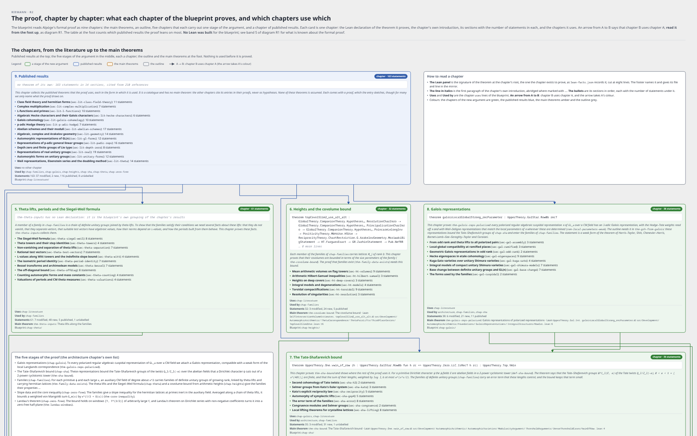

# Scott Cochran

I write TLA+ specifications and machine-checked proofs, mostly about making AI agents safe by design: treat every
agent as Byzantine, keep models out of the trusted base, and prove what the rules still guarantee.

### Projects

| | |
|---|---|
| [**TOPAK**](https://github.com/scottcochran/TOPAK) | A safe-by-design architecture pattern for agentic AI: TLA+ specifications, Cedar and OPA policy, Multi-Paxos over the control plane, and agents as principals. |
| [**tla-kit**](https://github.com/scottcochran/tla-kit) | TLC, TLAPS and an MCP server in one container, so an agent can check a specification and repair a proof. Needs only Docker. |
| [**gov-tla**](https://github.com/scottcochran/gov-tla) | The procedural core of the US Constitution, model-checked and proved. |
| [**TLAPS-issues**](https://github.com/scottcochran/TLAPS-issues) | Two false theorems that the TLA+ Proof System proves, with reproductions. |
| [**riemann-diagrams**](https://github.com/scottcochran/riemann-diagrams) | Teaching posters of the dependency graph of Levent Alpöge's Lean proof of the Riemann Hypothesis. |

Coming: the FIA Formula 1 regulations and the rules of snooker as TLA+ specifications.

From [riemann-diagrams](https://github.com/scottcochran/riemann-diagrams): the proof, chapter by chapter.
Click for the full poster.

### How I work

Every property has a mutation that must break it. Every results file is generated by a script, never edited by
hand. Every project says what it does not show.

### Get in touch

Open to collaboration on, and review of, formal verification of agent systems.
